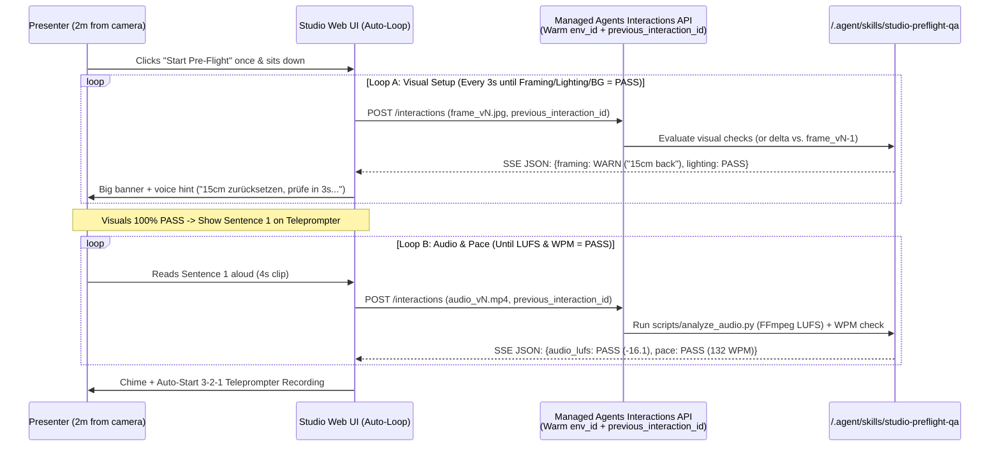

# Greenfield Blueprint: Skill-Driven AI Video Studio on Google Cloud

> [!IMPORTANT]
> **Design Philosophy (Pure Business Requirements)**: Build a **"Self-Service TV Studio in a Browser"** where journalists go from **Article → Pre-Flight Camera Check → Teleprompted Recording → Auto-Edited Video** in minutes, and where **100% of editorial rules, studio checks, and show formats live in `SKILL.md` files**—so adding a new check or launching a new show requires **zero UI or backend code changes**.

---

## 1. Pure Business Requirements (Stripped of Legacy Implementation Bias)

| Stage | User Experience (Journalist / Presenter) | Business Requirement |
| :--- | :--- | :--- |
| **1. Script Prep** | Paste an article or notes and pick a show format (e.g., *Studio Analyse*). | Automatically structure text into spoken-word teleprompter blocks with pacing cues and target duration. |
| **2. Studio Pre-Flight** | Sit in front of camera/mic and record a **3-second test snippet** (or live preview). | Act as a virtual studio director: check **framing/distance, lighting, background, mic loudness, and speaking pace**, and display plain-language corrections before recording starts. |
| **3. Recording & Post-Production** | Read from the teleprompter (even with stumbles/retakes) and click **Finish**. | Automatically remove retakes/flubs and long pauses, normalize audio, crop into target aspect ratios (16:9 / 9:16), apply brand lower-thirds/captions, and run a final QA check. |
| **4. Ongoing Maintenance** | Editorial/production team tweaks rules or launches a new show format. | **Maintainable purely via Skills (`SKILL.md`)**: adding a new quality check or show format must automatically appear in the UI and workflow without redeploying the app. |

---

## 2. How to Build It From Scratch: The 3-Component Architecture

Instead of building separate systems for real-time streaming, text prompting, and video post-production, we unify all three stages into **one uniform pattern**: **Thin Capture UI → Single Managed Agent Session → Two-Tier Skill Registry**.

```mermaid
flowchart LR
    subgraph UI["1. Thin Studio Web App (Stateless UI)"]
        Capture["Webcam / Mic Capture<br/>& Teleprompter View"]
        Renderer["Schema-Driven UI Renderer<br/>(Renders any checks[] JSON array)"]
    end

    subgraph Runtime["2. Gemini Enterprise Agent Platform"]
        Interactions["Managed Agents Interactions API<br/>(One warm sandbox env_id per session)"]
        Gemini["Gemini Multimodal / Omni<br/>(Native video, audio & text reasoning)"]
        Toolbox["Sandbox Media Toolbox<br/>(FFmpeg + Python pre-installed)"]
    end

    subgraph Skills["3. Skill Registry (/.agent/skills/)"]
        ShowSkills["Show Playbook Skills<br/>(e.g. seneca-show-aktuell/SKILL.md)"]
        CapSkills["Atomic Check & Edit Skills<br/>(framing, audio, teleprompter, smart-cut)"]
    end

    Capture -->|1. Upload 3s pre-flight or raw take to GCS| Interactions
    Interactions <-->|2. Auto-mount all skills| Skills
    ShowSkills -->|3. Orchestrates| CapSkills
    CapSkills -->|Semantic analysis| Gemini
    CapSkills -->|Exact dB / frame cuts| Toolbox
    Interactions -->|4. SSE stream: checks[] + edl.json + final.mp4| Renderer
```

### Why This Greenfield Design Is Radically Simpler
1. **Hands-Free, Two-Step Pre-Flight Iteration Loop (No Mouse Needed at the Desk)**:
   - Because the presenter sits 1.5–2 meters away from the camera, they cannot keep walking back to the mouse to click "Re-test". The UI runs an **automatic hands-free retry loop** backed by the warm sandbox (`environment_id` + `previous_interaction_id`):
     - **Loop A — Fast Visual Iteration (Single JPEG Frame every 3s)**: Framing, camera distance, lighting, and background only require **one still frame (`frame_v1.jpg`)**, not a video clip. If `framing` or `lighting` fails, the UI displays a large coaching banner (plus optional TTS audio) and automatically captures `frame_v2.jpg` 3 seconds later, passing `previous_interaction_id` so the Agent compares `v2` vs. `v1` (*"Better, 10cm further back—now centered"*) and re-evaluates only the failed visual checks.
     - **Loop B — Spoken First-Sentence Audio & Pace Check (4s Clip)**: Once all visual checks are `PASS`, the teleprompter displays the **actual first sentence of the script** and prompts the presenter to read it aloud. The Agent runs `analyze_audio.py` (`ffmpeg ebur128` LUFS + WPM) on that 4-second clip (`audio_v1.mp4`). If gain or pace needs adjustment, it auto-retries just the spoken sentence; once green, it **auto-starts the 3-2-1 recording countdown**.



2. **A "Dumb" Schema-Driven UI (Zero Hardcoded Checks)**:
   - The frontend does **not** have hardcoded UI components for "Lighting", "Volume", or "Camera Distance".
   - Instead, the UI simply renders whatever `checks[]` array the Agent returns:
     ```json
     {
       "overall_status": "WARN",
       "checks": [
         {"id": "lighting", "label": "Beleuchtung", "status": "PASS", "message": "Gesicht gleichmässig ausgeleuchtet."},
         {"id": "framing", "label": "Kameradistanz & Bildausschnitt", "status": "WARN", "message": "Bitte ca. 15 cm zurücksetzen (zu wenig Kopfraum)."},
         {"id": "audio_lufs", "label": "Mikrofon-Pegel", "status": "PASS", "message": "-16.2 LUFS (Optimal, kein Clipping)."}
       ]
     }
     ```
   - **Result**: When someone adds a 4th check in `SKILL.md` tomorrow (e.g., *"Check for striped shirt moiré"*), a 4th badge automatically appears in the UI with zero frontend code changes.

---

## 3. The Secret to Easy Maintenance: A 2-Tier Skill Taxonomy

To make the system maintainable by both engineers and non-technical producers, split `/.agent/skills/` into **two layers**:

```text
/.agent/skills/
├── shows/                                 # <-- LAYER 1: Edited by Producers in Plain Markdown
│   ├── seneca-show-aktuell/
│   │   └── SKILL.md                       # Defines which checks, prompts & exports apply to the flagship show
│   └── seneca-show-finanz-kompakt/
│       └── SKILL.md                       # 60s 9:16 vertical format with faster pacing
│
└── capabilities/                          # <-- LAYER 2: Reusable Atomic Building Blocks
    ├── check-studio-visuals/
    │   └── SKILL.md                       # Multimodal Gemini check for framing, lighting, background
    ├── check-audio-and-pace/
    │   ├── SKILL.md                       # Rubric for loudness (LUFS), noise floor & WPM
    │   └── scripts/analyze_audio.py       # Deterministic FFmpeg ebur128 measurement
    ├── prep-teleprompter-script/
    │   └── SKILL.md                       # Converts article text into spoken teleprompter chunks
    └── auto-cut-and-master/
        ├── SKILL.md                       # Gemini Omni retake/stumble detection -> EDL timestamps
        └── scripts/render_cuts.py         # Deterministic FFmpeg splice, 9:16 crop & audio normalization
```

### Layer 1: "Show Playbook Skills" (100% Plain Markdown — No Code)
A producer creating or updating a show only edits `shows/seneca-show-aktuell/SKILL.md`:

```markdown
---
name: seneca-show-aktuell
description: Production playbook for "Studio Analyse" (geopolitical commentary, 3-5 min).
---

# Show Playbook: Studio Analyse

## 1. Script Preparation (`phase: script`)
Use skill `prep-teleprompter-script` with these parameters:
- **Tone**: Analytical, calm, authoritative Seneca style; short spoken main clauses.
- **Target Pace**: 130 words per minute (mark `[PAUSE]` between topic shifts).

## 2. Studio Pre-Flight Check (`phase: preflight`)
Run `check-studio-visuals` and `check-audio-and-pace` against these thresholds:
- **Camera Framing**: Presenter centered, eyes at upper third, shoulders visible.
- **Lighting**: No backlight from windows; check for glasses reflection.
- **Background**: Clean office or Seneca map backdrop; no visible clutter.
- **Audio & Pace**: Target -16 LUFS (+/- 2 LUFS), max speaking pace 140 WPM.

## 3. Post-Production (`phase: postprod`)
Run `auto-cut-and-master`:
- **Retake Logic**: If presenter repeats a sentence or stumbles, keep only the final clean take.
- **Pause Removal**: Trim silent pauses longer than 0.7 seconds down to 0.25 seconds.
- **Deliverables**: Render 16:9 Master (`master_16x9.mp4`) and 9:16 Social Cut (`reel_9x16.mp4`).
```

### Layer 2: "Atomic Capability Skills" (`SKILL.md` + Deterministic Helper Scripts)
Each capability skill combines **Gemini's multimodal understanding** (what only an AI can judge) with a **small deterministic script** (what code does cheaply and accurately):
- **Why this matters**: Gemini Omni looks at the video once to understand *what* happened (*"Moderator stumbled at `01:12.4` and restarted the sentence at `01:16.0`"*), writing a tiny `edl.json` file. Then `scripts/render_cuts.py` uses `ffmpeg` inside the sandbox to cut and encode the video in seconds for **zero LLM tokens**.

---

## 4. End-to-End Runtime on Google Cloud (3 API Calls Total)

When built from scratch on the **Gemini Enterprise Agent Platform**, the entire backend is just **one Agent definition** (with wildcard Skill Registry mounting) and **three `Interactions API` calls** reusing the same `environment_id`:

| Step | Trigger from Web UI | `Interactions API` Prompt Sent to Warm Sandbox (`env_id`) | What Happens Inside the Managed Sandbox |
| :--- | :--- | :--- | :--- |
| **Step 1** | Journalist selects *Studio Analyse* & pastes draft | `"Run phase 'script' of skill 'seneca-show-aktuell' on draft.txt"` | Reads Show Skill → formats spoken blocks → returns `teleprompter.json`. |
| **Step 2** | Journalist records 3s test clip (`preflight.mp4`) | `"Run phase 'preflight' of skill 'seneca-show-aktuell' on /workspace/media/preflight.mp4"` | Runs `analyze_audio.py` (`ffmpeg`) + Gemini vision/audio check on clip → returns `checks[]` JSON badges in ~2–3s. |
| **Step 3** | Journalist records take (`raw_take.mp4`) & clicks **Finish** | `"Run phase 'postprod' of skill 'seneca-show-aktuell' on /workspace/media/raw_take.mp4"` | Gemini Omni extracts retake/pause timestamps (`edl.json`) → `render_cuts.py` (`ffmpeg`) cuts & masters `16:9` + `9:16` MP4s to GCS. |

---

## 6. Live Deployed Prototype on Argolis (`your-gcp-project-id`)

### 6.1 Provisioned Agent Platform Resources
- **Project**: `your-gcp-project-id` (`123456789012`)
- **Managed Agent (`global`)**: `projects/your-gcp-project-id/locations/global/agents/seneca-studio-agent`
  - **Base Agent**: `antigravity-preview-05-2026`
  - **Tools**: `code_execution`, `filesystem`, `google_search`, `url_context`
  - **Environment Mount**: `type: "skill_registry"`, `source: "projects/123456789012/locations/europe-west4/skills"`, `target: "/.agent/skills"`
- **Skill Registry Resources (`europe-west4`, all `ACTIVE`)**:
  1. `projects/123456789012/locations/europe-west4/skills/seneca-show-aktuell` (*Show Playbook: Studio Analyse*)
  2. `projects/123456789012/locations/europe-west4/skills/seneca-seneca-show-finanz-kompakt` (*Show Playbook: Finanz Kompakt*)
  3. `projects/123456789012/locations/europe-west4/skills/seneca-check-studio-visuals` (*Capability: Loop A Visual Studio Check*)
  4. `projects/123456789012/locations/europe-west4/skills/seneca-check-audio-pace` (*Capability: Loop B Audio & Pace Check + `scripts/analyze_audio.py`*)
  5. `projects/123456789012/locations/europe-west4/skills/seneca-prep-teleprompter` (*Capability: Stage 1 Teleprompter Script Prep*)
  6. `projects/123456789012/locations/europe-west4/skills/seneca-auto-cut-master` (*Capability: Stage 3 Smart-Cut + `scripts/render_cuts.py`*)

### 6.2 Live Webcam & Microphone Testing Workflow
1. **Enable Camera & Mic**: Click **🎥 Kamera & Mikrofon aktivieren** in the top bar. Your browser streams your live webcam feed (`16:9`) and live microphone level meter directly in the Studio Monitor.
2. **Loop A — Live Visual Pre-Flight Check**:
   - Click **📸 Live-Frame jetzt prüfen** (single snapshot) or **🔄 Hands-Free Auto-Loop (alle 4s)** (hands-free 4-second countdown loop with German voice feedback via `speechSynthesis`).
   - Every check card returned on the right (`framing`, `lighting`, `background`, plus any custom rule) is dynamically generated from the active `SKILL.md`—no frontend hardcoding.
3. **Zero-Code Skill Maintenance Test**:
   - Open **⚙️ Skill Registry (`SKILL.md` Live-Editor)** in the top right.
   - Select `seneca-show-aktuell` or `seneca-check-studio-visuals`, click one of the 1-click test rules (**`+ Kaffeetassen-Verbot`**, **`+ Kopfhörer-Verbot`**, or **`+ Gesichtsausdruck`**), and click **💾 Speichern & Skill Registry patchen**.
   - Hold a coffee mug or wear headphones in front of your webcam and click **📸 Live-Frame jetzt prüfen**: a brand-new check card (`coffee_cup` or `headset_check`) immediately appears and evaluates your live webcam frame.
4. **Loop B — Live Spoken First-Sentence Check**:
   - Switch to **2. Pre-Flight Loop B (Audio)**, click **🎙️ Ersten Satz live einsprechen (5s)**, and read the highlighted first sentence aloud into your microphone.
   - The backend converts your WebM recording to WAV (`48 kHz`), runs deterministic `ffmpeg -af ebur128` (`scripts/analyze_audio.py`) for exact Integrated Loudness (LUFS) & True Peak (dBTP), and evaluates WPM & acoustics with Gemini against the show skill.
5. **Stage 3 — Teleprompter Recording & Smart-Cut**:
   - Switch to **3. Teleprompter & Smart-Cut**, click **🔴 Teleprompter-Take aufnehmen (10s)**, and speak the scrolling teleprompter text (deliberately include a cough, pause, or retake).
   - Gemini multimodal generates `edl.json` and `scripts/render_cuts.py` (`ffmpeg`) splices your live webcam recording and normalizes loudness to `-16 LUFS` (`16:9 Master` + `9:16 Social Reel`).

